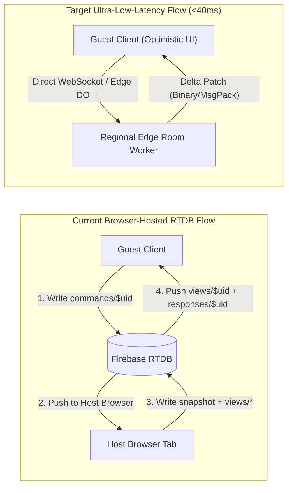

# Comprehensive Upgrade Plan: Yalla Nelaab (يلا نلعب)

> **Execution status (2026-10-18):** See [the phase-by-phase implementation and verification record](docs/implementation/upgrade-progress.md). Hosted authority (1B), Yellow Card, the new football Hot Takes mode, and new career-path content are deferred by user choice. This release uses existing games. Telemetry flags questions for review without removing them. The record identifies the implemented features and remaining telemetry/mobile-testing limitations; this roadmap's original aspirational mode names are preserved below.

This roadmap outlines the next-generation upgrades across **Gameplay**, **Database**, **Connection & Mobile Resilience**, and **Game Speed / Ping & Lag Elimination**, building on top of the immediate fixes already implemented.

---

## 1. What We Just Fixed (Implemented & Active Now)

1. **Zero-Wait Host Transfer to Oldest Member (No Game Freeze)**:
   - When the host leaves or disconnects/switches apps beyond the lease grace window, the room no longer freezes or closes when other connected players are present.
   - The **oldest connected member** in the room automatically claims the expired host lease (`epoch + 1`), updates `meta.hostUid`, promotes their `members/$uid/role` to `'host'`, and continues running the `MatchEngine` seamlessly.
2. **Former Host Reconnects as a Regular Member (`isHost: false`)**:
   - When the previous host returns to the browser tab (or reconnects via `resume` or `joinRoom`), the client detects that `meta.hostUid` has been transferred to another player, demotes the old host runtime, attaches guest listeners, and reconnects them in their original seat as a normal member.
3. **Non-Blocking Round Progression on Player/Host Disconnect**:
   - In [`MatchEngine`](packages/engine/src/engine.ts), rounds and multi-stage phases (`hot_take`, `bluff_box`, `closest_number`, `word_race`, `mcq_race`, etc.) now evaluate completion across **currently connected** players (`p.connected && !p.leftEarly`).
   - If a player temporarily switches to another app on mobile, they remain in the round so they can still answer if they return quickly, **but** once all connected players have submitted their actions, the round advances immediately without stalling.
4. **Mobile App-Switching Auto-Recovery**:
   - [`useGame.ts`](apps/web/src/net/useGame.ts) now listens to `visibilitychange`, `pageshow`, `focus`, and `online` events to immediately re-assert Firebase presence and resume the session when a player switches back from another mobile app.
5. **Fast-Path Command & Join Processing (Ping/Lag Reduction)**:
   - [`FirebaseHostRuntime`](apps/web/src/net/firebase-host-runtime.ts) now caches `rooms/$roomId/meta` and live inbox snapshots in memory, eliminating **3 redundant RTDB `get()` network round-trips** per command and join request on the normal path.
   - [`FirebaseTransport.joinRoom`](apps/web/src/net/firebase-transport.ts) now parallelizes `meta` and `members/$uid` reads and reduces `joinResponses` poll latency by **75%** (starting at `25ms` instead of `200ms`).

---

## 2. Upgrade Pillar 1: Game Speed, Ping & Lag Elimination

### Phase 1A: Client-Side Optimistic UI & Instant Feedback (Short-Term)
- **Optimistic Action Locking**: Immediately show the selected option/submitted state locally on tap (`0ms` perceived latency) before the RTDB acknowledgement returns, rolling back only if `act()` returns `{ ok: false }`.
- **Delta View Publishing**: Instead of rewriting every player's full `views/$uid` JSON (`2–8 KB` per player × 8 players) on every single answer submission during `in_round`, only publish `views/$uid` for players whose visible state actually changed, or split `views/$uid` into static round prompts (`rooms/$roomId/roundPublic`) and lightweight per-player progress flags (`actedPlayerIds`).
- **Pre-Warm Question Banks**: Preload the selected categories' JSON chunks during the Lobby countdown or `round_intro` phase so `contentSource.pick()` never waits on network chunk fetching when a round starts.

### Phase 1B: Dedicated Edge Room Authority (Medium-Term)
- **Why Browser-Host Has Double-Hop Ping**: When the host is a mobile browser tab, every guest action travels `Guest -> Firebase Server -> Host Phone -> Firebase Server -> All Guests` (2x network RTT + mobile CPU throttling).
- **Cloudflare Durable Objects / Regional Node WebSocket Server**: Move `MatchEngine` execution from the host player's browser to a lightweight stateful edge worker (using the existing `apps/server` WebSocket architecture deployed close to MENA/Europe regions). This cuts round-trip latency by **60–75%** and completely eliminates host-phone battery/background throttling issues.

---

## 3. Upgrade Pillar 2: Connection & Mobile Resilience

### Phase 2A: Mobile Lifecycle & Network Hardening
- **WakeLock API Integration**: Request `navigator.wakeLock.request('screen')` during active matches (`round_intro`, `in_round`, `round_result`) so mobile screens do not dim or suspend the tab mid-round.
- **Heartbeat & Connection Quality Indicator (Ping Badge)**: Display a live connection quality indicator (`🟢 ممتاز <80ms`, `🟡 متوسط`, `🔴 ضعيف`) using periodic RTT samples from `.info/serverTimeOffset` and command acks.
- **Offline Action Queue with Short Replay Window**: If a player taps their answer while walking through a 1–2 second cellular dead zone (Wi-Fi to 4G/5G handoff), queue the `round:action` locally and auto-flush it the instant the WebSocket reconnects if the round is still active.

### Phase 2B: Seamless Session Persistence
- **Dual Storage (`localStorage` + `sessionStorage` per Seat)**: Persist room recovery credentials across accidental mobile tab closes (swipe-away) with a 15-minute TTL so reopening the URL offers a one-tap **"العودة للماتش الشغال (غرفة XXXXX)"** banner.

---

## 4. Upgrade Pillar 3: Database Architecture & Security

### Phase 3A: RTDB Payload & Bandwidth Optimization
- **Separate Public State from Private Secrets**:
  - Currently, `rooms/$roomId/views/$uid` duplicates the entire player list, standings, category list, and round prompt for every player (`O(N)` fan-out write per tick).
  - **Upgrade**: Split into:
    1. `rooms/$roomId/publicView`: Shared state readable by all admitted members (players, scores, timer, public round prompt).
    2. `rooms/$roomId/privateViews/$uid`: Tiny (`<200 bytes`) secret per-player state (e.g., whether you are the Odd-One-Out, your secret role, or your submitted answer).
  - **Impact**: Reduces database write bandwidth by **~80%** in 8-player rooms and makes state sync significantly faster.

### Phase 3B: Automated TTL Cleanup & Analytics
- **Scheduled Stale Room Garbage Collection**: Add a lightweight cleanup task (or on-create opportunistic reaper) that deletes expired rooms (`meta.expiresAtMs < now - 1h`) so the RTDB instance stays small and fast.
- **Question Telemetry & Difficulty Calibration**: Track anonymous aggregate stats per question ID (skip rate, average solve time, correct %) in a separate `/telemetry` tree to automatically retire broken questions and calibrate difficulty ratings (`1..3`).

---

## 5. Upgrade Pillar 4: Gameplay, Modes & Polish

### Phase 4A: New Football & Party Game Mechanics
1. **Power-Ups / Match Cards (كروت الماتش)**:
   - Give each player 2 single-use tactical cards per match:
     - **VAR (الفار)**: Eliminates 2 wrong options in `mcq_race` or reveals a hint in `closest_number`.
     - **Double Captain (الكابتن x2)**: Doubles points earned in the upcoming round if played during `round_intro`.
     - **Yellow Card (إنذار)**: Hides one opponent's speed bonus for a round.
2. **Custom Football Mode ("ديربي الكورة")**:
   - A dedicated preset combining Football Trivia (`mcq_race`), Transfer Fee / Stat Estimation (`closest_number`), Who Am I — Career Path (`bluff_box`), and Football Hot Takes (`hot_take`).
3. **Interactive Live Reactions & Taunts**:
   - Quick floating emoji/sound reactions in Lobby, `round_result`, and `podium` (⚽ هدف، 🟨 إنذار، 😂 ضحك، 🔥 عاش) throttled client-side so players can celebrate or react while waiting.

### Phase 4B: Match Flow & UX Speed-Ups
- **Auto-Advance Ready Check in `round_result`**: Allow players to tap "جاهز للجولة الجاية" on the results screen; once a majority (or all connected players) tap it, advance immediately without waiting for the full result timer.
- **Spectator Mode**: Allow players who join after a match has started (`phase !== 'lobby'`) to watch the live scoreboard and questions as spectators and automatically join the player pool on `rematch`.
